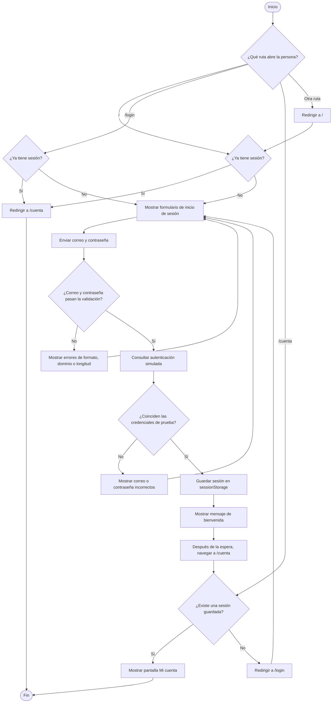

# Diagrama de actividades: inicio de sesión

Este flujo representa la implementación actual de HU-1 en `src/page/Login.jsx`, `src/utils/validaciones.js`, `src/auth/mockApi.js`, `src/auth/session.js` y `src/App.jsx`.

La validación impide enviar campos vacíos, correos con formato no válido, dominios temporales o no confiables y contraseñas menores de 12 caracteres. La autenticación es simulada en el frontend; no hay una API de login conectada.

## Conclusión

El diagrama incluye los caminos de campos válidos e inválidos y las decisiones de acceso a rutas públicas y protegidas.  
Un correo o contraseña inválidos muestran ayuda en el formulario y no llaman a la autenticación simulada.  
Las credenciales incorrectas muestran un mensaje de error y permiten volver a intentar.  
Las credenciales correctas guardan la sesión y llevan a la cuenta.  
La ruta de cuenta comprueba la sesión antes de mostrar información interna.  
La validación, los mensajes, el inicio de sesión simulado y la protección de rutas existen en el código actual.  
La conexión a una API real y el cierre por inactividad todavía no están implementados.
