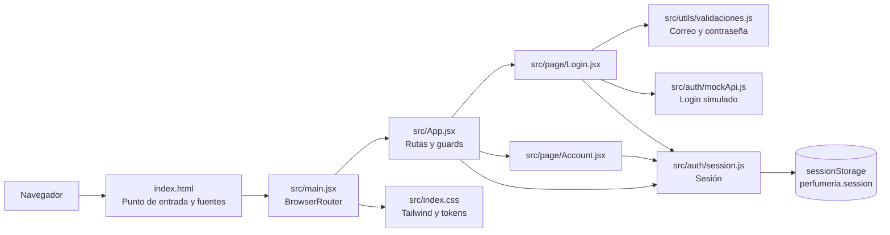

# Diagrama de componentes

El diagrama describe los módulos que existen hoy en el frontend. Las flechas muestran dependencias de uso.

No hay todavía componentes compartidos en `src/components/`, catálogo, carrito, backend ni integración con API. La autenticación del diagrama usa `mockApi.js`.
