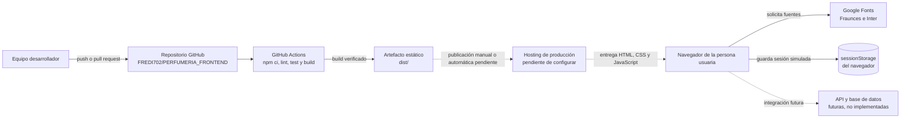

# Diagrama de despliegue

El flujo distingue la compilación configurada de un despliegue de producción, que todavía no está conectado.

GitHub Actions ejecuta lint, pruebas y build. El build produce `dist/`; el workflow actual no publica ese artefacto en un hosting. La sesión se guarda en el `sessionStorage` del navegador y el inicio de sesión se simula localmente. La API y la base de datos son futuras y no tienen endpoints definidos.
